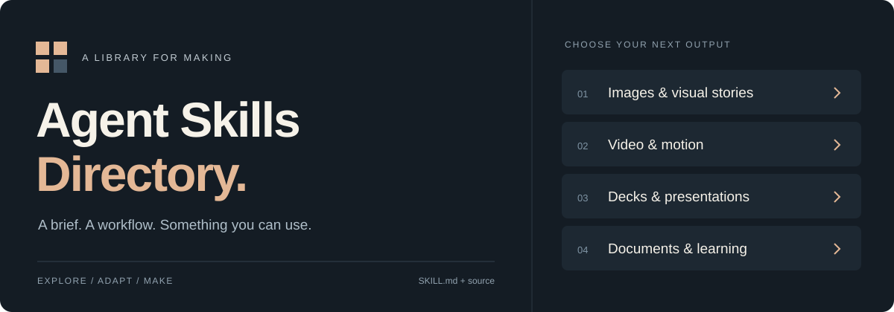
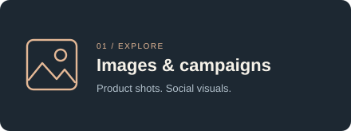
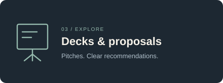
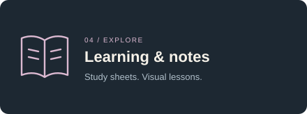
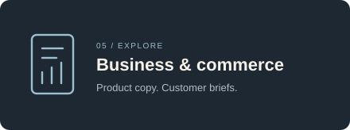
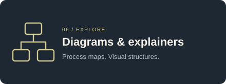

<p align="center">
  
</p>

<h1 align="center">Agent Skills Directory</h1>

<p align="center">
  Reusable instructions, scripts and templates for making things with AI agents.<br />
  Find a workflow, bring your own brief, and make it yours.
</p>

<p align="center">
  <a href="CATALOG.md"></a>
  <a href="https://github.com/dipakkr/awesome-agent-skills/stargazers"></a>
  <a href="https://github.com/dipakkr/awesome-agent-skills/forks"></a>
  <a href="https://github.com/dipakkr/awesome-agent-skills/commits/main"></a>
  <a href="LICENSE"></a>
  <a href="CONTRIBUTING.md"></a>
</p>

<p align="center">
  <a href="CATALOG.md"><strong>Browse skills</strong></a> &nbsp;·&nbsp;
  <a href="#get-started">Get started</a> &nbsp;·&nbsp;
  <a href="#what-would-you-like-to-make">Explore categories</a> &nbsp;·&nbsp;
  <a href="CONTRIBUTING.md">Contribute</a>
</p>

A skill is a repeatable workflow your agent can read and follow. Each folder
contains a `SKILL.md` entry point, plus the supporting source needed for that
job. Browse by what you want to make, then read the skill's requirements before
running it. Tool access and setup vary by workflow.

## Supported by

<table>
  <tr>
    <td width="220" align="center">
      <a href="https://tooljunction.io"></a>
    </td>
    <td>
      <strong><a href="https://tooljunction.io">ToolJunction</a></strong><br />
      Discover AI tools, startup credits and perks for your next project.<br />
      <a href="https://tooljunction.io">Explore ToolJunction →</a>
    </td>
  </tr>
</table>

## What would you like to make?

<table>
  <tr>
    <td width="33%" valign="top">
      <a href="skills/benefit-panels/SKILL.md"></a><br />
      <a href="skills/benefit-panels/SKILL.md">Benefit Panels</a><br />
      <a href="skills/wardrobe-campaigns/SKILL.md">Wardrobe Campaigns</a>
    </td>
    <td width="33%" valign="top">
      <a href="skills/talking-models/SKILL.md"></a><br />
      <a href="skills/talking-models/SKILL.md">Talking Models</a><br />
      <a href="skills/words-in-motion/SKILL.md">Words In Motion</a>
    </td>
    <td width="33%" valign="top">
      <a href="skills/funding-story/SKILL.md"></a><br />
      <a href="skills/funding-story/SKILL.md">Funding Story</a><br />
      <a href="skills/client-offer-builder/SKILL.md">Client Offer Builder</a>
    </td>
  </tr>
  <tr>
    <td width="33%" valign="top">
      <a href="skills/memory-drills/SKILL.md"></a><br />
      <a href="skills/memory-drills/SKILL.md">Memory Drills</a><br />
      <a href="skills/drawn-lessons/SKILL.md">Drawn Lessons</a>
    </td>
    <td width="33%" valign="top">
      <a href="skills/merchant-intake/SKILL.md"></a><br />
      <a href="skills/merchant-intake/SKILL.md">Merchant Intake</a><br />
      <a href="skills/listing-copywriter/SKILL.md">Listing Copywriter</a>
    </td>
    <td width="33%" valign="top">
      <a href="skills/team-atlas/SKILL.md"></a><br />
      <a href="skills/team-atlas/SKILL.md">Team Atlas</a><br />
      <a href="skills/concept-layers/SKILL.md">Concept Layers</a>
    </td>
  </tr>
</table>

**[See the complete collection →](CATALOG.md)**

## Get started

| ① Pick a skill | ② Bring your brief | ③ Make it yours |
| --- | --- | --- |
| Browse the [catalog](CATALOG.md) and read its requirements. | Share your goal, source files and constraints. | Follow the workflow, review the output, and adapt it. |

Clone the repository, or download its ZIP using GitHub's **Code** menu:

```sh
git clone https://github.com/dipakkr/awesome-agent-skills.git
cd awesome-agent-skills
```

Open the folder in your coding agent and point it at a skill:

```text
Read skills/merchant-intake/SKILL.md and follow its workflow.

I am preparing a small homeware store. Help me organize my product facts,
audience and brand voice into a reusable brief. Ask for missing information
when it affects the result, and clearly mark anything we have not confirmed.
```

For another task, choose a different `SKILL.md` from the index and provide your
own brief, files and constraints. For automatic skill discovery, install the
**whole skill folder** using your agent's supported installation workflow.
Keep its scripts, reference files and assets together.

## Give your agent useful inputs

Tell it what you want to make, who it is for, where it will be used, and which
facts or assets must stay unchanged. Include dimensions, duration or format when
relevant. Specify the output folder and any spending or tool restrictions.

Example:

```text
Read skills/punchy-photo-cards/SKILL.md.

Create a social image for my ceramics workshop using the attached photo.
Keep the supplied logo unchanged. Use the headline “Make something by hand”.
Save the image, prompt and editable brief in ./output/workshop.
Use only tools already available in this session.
```

The skill's own instructions describe its required inputs, steps and review
criteria. Check the result against your source material before publishing it.

## Requirements and outputs

- Use an agent that can read workspace files and follow skill instructions.
- Some skills need image generation, document tooling, Python, Node.js, FFmpeg
  or a browser. Read the selected skill before installing dependencies.
- Provider subscriptions and generation usage are separate from this repository.
- Outputs vary: images, videos, decks, briefs, structured files or editable code.
  A skill's presence here does not establish compatibility with every agent.

Reusable example briefs and source assets are included where available. Large
rendered demo exports are omitted. The source index is text-only.

## Explore a skill folder

```text
skills/<name>/
├── SKILL.md       Instructions and workflow
├── scripts/       Helpers, when the workflow needs them
├── references/    Contracts, guidance and supporting material
├── assets/        Reusable templates or source assets
└── examples/      Editable example inputs
```

Folders vary by skill. `catalog.json` records the source inventory and hashes.
Verify the collection locally with:

```sh
python3 scripts/validate.py
```

Validation checks package structure and file integrity. Individual skills may
provide additional checks for their actual outputs.

## Contribute

Improve a workflow, report a reproducible problem, or propose a new skill.
Keep each skill addition in its own pull request. Include clear instructions,
required source files, licence notices and an honest account of what you tested.
See [CONTRIBUTING.md](CONTRIBUTING.md) for the contribution workflow.

## Licence and credits

Original instructions and code use [MIT](LICENSE). Embedded fonts, libraries and
other third-party materials retain their notices and terms. See [LICENSING.md](LICENSING.md).
Maintained by [Deepak](https://github.com/dipakkr).
